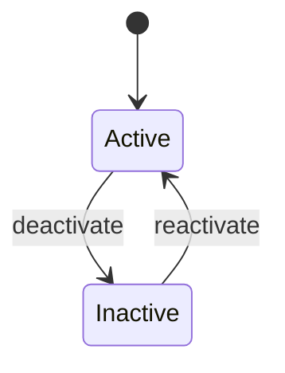

# School status (Req 3)

| Feature | Inactive | Active |
|---|---|---|
| Student | Cannot assign new students; existing students stay visible, read-only. | Assignment allowed. |
| Class / Level | Classes cannot be added or edited. | Maintained as normal. |
| Top-up | Excluded from batch rules and ad-hoc top-ups. | Eligible. |
| Fee | No new fee charges; outstanding fees can still be paid. | Fees charged each cycle. |
| FAS / Budget | No new SBFAS grants; past grants and budget history kept. | SBFAS can be granted. |
| Parent portal | Children show a "school inactive" note; payments still work. | Normal. |

Assumption: these effects are proposed by the team; the requirements do not define them.
